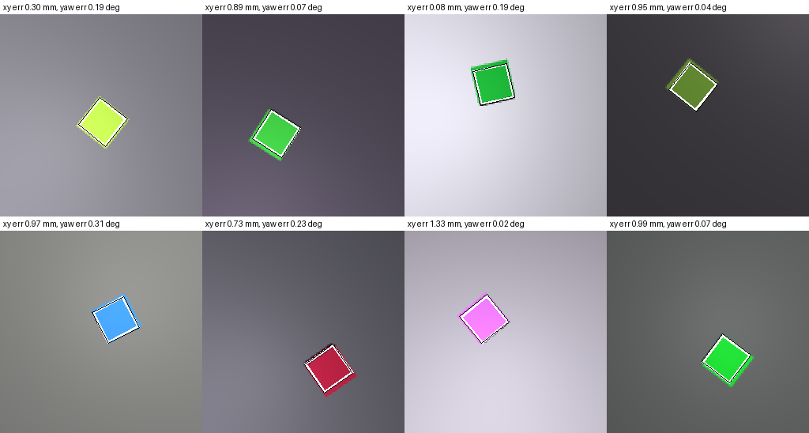
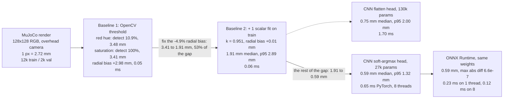

# mujoco-cube-pose-cnn

Estimates the planar pose `(x, y, yaw)` of a cube from one 128x128 MuJoCo render: a 27k-parameter CNN with a soft-argmax head reaches 0.59 mm median error against 1.91 mm for a calibrated OpenCV baseline, in about 0.2 ms on one thread through ONNX Runtime.



The tracked ONNX model on the first 8 `hard` val images, not selected: white = ground truth, black = prediction (`scripts/make_demo.py`, needs `data/`).

All numbers: `hard` regime (random hue, light, table shade), `val` split, n=2000, median xy error unless stated.



### Results

| method | params | regime | detect | median xy | p95 xy | median yaw | p95 yaw | latency |
|---|---|---|---|---|---|---|---|---|
| OpenCV, fixed red hue | 0 | `hard` | **10.9%** | 3.48 mm | 6.07 | 0.19 deg | 1.24 | 0.06 ms |
| OpenCV, saturation | 0 | `hard` | 100% | 3.41 mm | 5.57 | 0.19 deg | 1.66 | 0.05 ms |
| **v2** OpenCV + 1 calibrated scalar | 1 | `hard` | 100% | 1.91 mm | 2.89 | 0.19 deg | 1.66 | 0.06 ms |
| CNN, flatten head | 130k | `hard` | 100% | 0.75 mm | 2.00 | 0.28 deg | 0.94 | 1.70 ms |
| CNN, soft-argmax head | **27k** | `hard` | 100% | **0.59 mm** | **1.32** | 0.21 deg | **0.66** | 0.65 ms |
| same, ONNX Runtime, 1 thread | 27k | `hard` | 100% | 0.59 mm | 1.32 | 0.21 deg | 0.66 | **0.23 ms** |
| same, ONNX Runtime, 8 threads | 27k | `hard` | 100% | 0.59 mm | 1.32 | 0.21 deg | 0.66 | **0.12 ms** |

One-thread ONNX latency moves between runs on this laptop: 0.23 ms in the table, 0.27 ms in the committed `runs/hard_softargmax/onnx_report.json`, 0.19 to 0.23 ms in reruns on 2026-11-21. Read it as about 0.2 ms; the accuracy columns are exact across runs.

The `easy` regime, the radial-bias column, INT8 results and how each was found: [docs/RESULTS.md](docs/RESULTS.md).

## Quick start

Linux, Python 3.10+, CPU only.

```bash
git clone <this repo URL>
cd mujoco-cube-pose-cnn
python3 -m venv .venv && . .venv/bin/activate        # first time only
pip install --index-url https://download.pytorch.org/whl/cpu \
    --extra-index-url https://pypi.org/simple -r requirements.txt   # first time only
./verify.sh
# tier 1: yaw fold, projection, metric, head parameter counts, all "ok", under 10 s.
# Without data/ it stops there and prints the two commands that render it (~30 s, one thread);
# run them and ./verify.sh again to re-score the tracked checkpoints through PyTorch and ONNX Runtime.
python test_readme.py   # the table above against runs/*/metrics.json
```

## How it works

- `gen_dataset.py` renders a cube at a random pose under an overhead camera; `easy` keeps colours fixed, `hard` randomises hue, light and table shade.
- `baseline_cv.py`: threshold, contour, `minAreaRect`, then one scalar fitted on train removes the radial bias.
- `model.py`: small CNN with a flatten head or a spatial soft-argmax head; `export_onnx.py` and `quantize_int8.py` for ONNX Runtime fp32 and INT8.

## License

MIT, see LICENSE.
